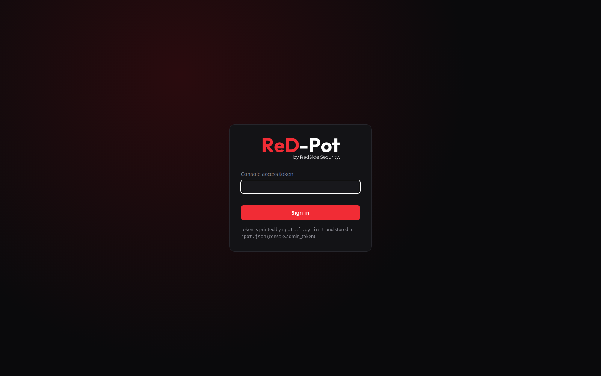

# Installing and running ReD-Pot

This guide covers ReD-Pot Community Edition 1.0.0 from a fresh server to day-2 operations. If you only want the short
version, see [Quick start in the README](../README.md#quick-start).

- [1. What you need](#1-what-you-need)
- [2. Plan your network (5 minutes)](#2-plan-your-network-5-minutes)
- [3. Install the manager](#3-install-the-manager)
- [4. First login](#4-first-login)
- [4a. Add a decoy later](#4a-add-a-decoy-later-for-example-on-a-new-network-card)
- [5. Add a sensor on another server](#5-add-a-sensor-on-another-server)
- [6. alerts.json, events.json and Export](#6-alertsjson-eventsjson-and-export)
- [7. SOC wall screen](#7-soc-wall-screen)
- [8. Day-2 operations](#8-day-2-operations)
- [9. Unattended / scripted install](#9-unattended--scripted-install)
- [10. Uninstall](#10-uninstall)
- [11. Troubleshooting](#11-troubleshooting)
- [12. Lab without real servers](#12-lab-without-real-servers)

---

## 1. What you need

### Operating system

| | Minimum | Recommended |
|---|---|---|
| Distribution | Any **Debian-family** Linux with `apt` and systemd: **Ubuntu 22.04+** or Debian 12+ | **Ubuntu 24.04 LTS or 26.04 LTS** (or 22.04 LTS), server edition, minimal install |
| Tested on | — | Ubuntu 22.04 LTS and Ubuntu 26.04 LTS (real VMs, install → attack → reboot → uninstall) |
| Architecture | x86_64 (amd64) | x86_64. ARM64 should work (multi-arch base image) but is not tested yet |
| Kernel | any stock kernel with iptables (`xt_TTL` for the Windows TTL rule; without it the decoy keeps TTL 64) | the distribution's current LTS kernel |
| Python on the host | 3.8+ (only for the installer, which uses the standard library only) | the distribution's default `python3` |
| Docker | 20.10+ with the compose plugin, **installed automatically** if missing (the installer asks first) | the distribution's `docker.io` package, or Docker CE |
| Not supported | Windows, macOS, WSL, RHEL/Rocky/Alma (no `apt`), Alpine, containers inside containers | — |

### Hardware and network

| | Minimum | Recommended | Measured |
|---|---|---|---|
| **Manager** + local decoys: CPU | 1 vCPU | 2 vCPU | ~0–1 % idle |
| RAM | 1 GB | 2–4 GB | ~140 MB for the manager + 2 decoys (1.0.0); about 50 MB per extra decoy |
| Disk | 5 GB free | 20 GB SSD (90 days of events, alert archives) | image ~290 MB |
| Interfaces | 1 (holds **one** local decoy, which shares the management IP) | **2 to 4**: one for management, one per decoy | — |
| **Sensor** (another server): CPU / RAM | 1 vCPU / 512 MB | 1 vCPU / 1 GB | ~100 MB RAM |
| Disk | 3 GB free | 5 GB | — |
| Interfaces | 1 (the decoy may share it) | 1, or 2 if the decoy should sit in another VLAN | — |
| Link to the manager | any routed TCP path to the sensor API port | the same LAN or a VPN | ~0.6 kbit/s idle, ~5 MB/day |

### Also needed

- `root` or `sudo`.
- Internet access during the first install (apt packages, Docker image, optional ~18 MB GeoIP download).
  After that ReD-Pot runs fully offline.
- **Static (or DHCP-reserved) IPs** on the management interface and on every interface that holds a decoy, and correct
  time (NTP). Event timelines depend on it.

> **Virtual machines (VirtualBox / VMware / Hyper-V / Proxmox):** each decoy answers on the IP and MAC address of the
> VM's own network adapter, so no promiscuous mode or MAC spoofing is needed. To place decoys in several networks, give
> the VM one adapter per network. Wi-Fi interfaces work too.

## 2. Plan your network (5 minutes)

Answer three questions before you start:

1. **Which interface do *you* use to manage the server?** (your SSH session). That becomes the *management*
   interface. The web UI, the sensor API and host SSH answer **only** there.
2. **Which network(s) should the decoys appear in?** Usually your server / user VLANs, where an intruder would land.
   Each decoy needs **its own interface** in that network and answers on that interface's IP. One interface holds one
   decoy.
3. **Which servers should they pretend to be, with which names?** Up to 3 decoys in total (local decoys plus remote
   sensors). Use your real naming scheme (`RS-FS-02`, not `FS01`).

| Your situation | Choose |
|---|---|
| Office / data centre, server with 2–4 NICs | management NIC; one decoy on each other NIC (recommended: attackers never see the admin ports) |
| Server with one NIC inside the LAN | one decoy on that NIC; it shares the management IP and host SSH moves to a random port. Add more decoys as remote sensors |
| VPS with one public IP (internet-facing, like T-Pot) | the same as one NIC: one decoy on the server's address, SSH moves |
| Branch office / another VLAN | install a **sensor** there that reports to your manager |

## 3. Install the manager

```bash
git clone https://github.com/RedSideSecurity/ReD-Pot.git
cd ReD-Pot
sudo ./install.sh            # choose [1] Manager + decoys
```

The installer **downloads the prebuilt image** `ghcr.io/redsidesecurity/red-pot:1.0.0` and checks that it was built
from exactly the code you cloned (SHA-256 label). If the check fails, you changed the code, or there is no internet, it
builds the image `rpot:1.0.0` locally instead (a few minutes). Force a local build with `--build`.

The prebuilt image (linux/amd64 and linux/arm64) is built and published only by the release workflow
(`.github/workflows/release.yml`) from the tagged commit, after the full test suite passes. Its source-hash label is
computed with the installer's own `src_hash()`, so a clean clone of the same tag always matches. To check where an
image came from: `gh attestation verify oci://ghcr.io/redsidesecurity/red-pot:1.0.0 --repo RedSideSecurity/ReD-Pot`.

The wizard has 5 steps and a review screen. Type `back` at any question to return to the previous step;
nothing is changed until you press Enter on the review screen. `Ctrl+C` quits without changes.

| Step | What it asks | Notes |
|---|---|---|
| 1 Network | management interface | pre-selected: the interface of your SSH session. Interfaces that are down, have no IPv4 address or have an unusual name are listed as *Not usable* |
| 2 Your company | AD/DNS domain (for example `corp.example.com`), industry (bank, hotel, government, IT, generic) | company name, NetBIOS name and mail domain are derived from the domain and shown right away; users come from a built-in pool, random per install. There is no default domain |
| 3 Decoy servers | which roles: `1`, `1,3` or `none` | at most 3, and at most one per usable interface. `none` = a manager that only collects remote sensors |
| 4 Decoy interfaces and names | per decoy: interface (an interface already used by an earlier decoy is not offered), host name, and the front page for the web decoy (webmail, helpdesk, intranet) | the decoy answers on the interface's own IP; there is no address question. Host names 1–15 chars (Windows limit). Other services on that address are listed and can be stopped |
| 5 Access | static public IP (or `no`), GeoIP download, and **who may reach the web UI, the sensor API and host SSH** (three lists, `0.0.0.0/0` = anyone) | for everyone else the ports look **closed** (TCP reset, like any closed port). Your current SSH client is always allowed on the management interface (an IPv6 client too). When a decoy shares the management interface, all three lists default to your own SSH client address |

On the review screen type `1`–`5` to change a part, `q` to quit, or press **Enter** to install. The review shows the
derived company / NetBIOS / mail domain, how many of the 3 decoy slots the install uses, each decoy's interface and IP,
the firewall plan and what happens to host SSH. When a decoy shares the management interface, pressing Enter first
lists the host services that listen on that interface today (other than host SSH) and become unreachable there, for
example a VPN server, and asks you to confirm (default: no). The installer then:

1. installs Docker if needed and gets the `1.0.0` image (download or local build, see above),
2. generates the persona, the baits and honeytokens, and a new **TLS certificate** for the manager (looks like the company's internal PKI: `CN=<host>.<domain>`, issuer "<Company> Issuing CA"),
3. starts the manager and the decoys and installs the **`redpot` systemd service** (starts on boot),
4. if a decoy shares the management interface, moves host SSH to a random port. It listens on the new port first and
   keeps your current session open. If decoys sit only on other interfaces, SSH stays on 22 and listens only on the
   management IP,
5. runs a **self-test** of every decoy (container running, every port listening, a TCP connect to its address) and
   prints a ✓/✗ table. It also lists host services that listen on all addresses: the firewall closes them on decoy
   interfaces, so stop the ones you do not need. "ReD-Pot is ready" appears only when every decoy passed,
6. prints the summary below and saves it to `/opt/redpot/manager/INSTALL-INFO.txt` (readable by root only).
   The ports are also shown in the SSH login banner.

**The firewall** (`firewall.sh`, applied by the `redpot` service at every start and removed on stop and uninstall):

- On every decoy interface only that decoy's ports answer. Everything else gets the reply of a closed port (TCP reset,
  ICMP port unreachable), on IPv6 too, and the interface answers ARP only for its own address. This hides **all other
  host services** on that interface, including the management interface when a decoy shares it.
- The web UI, the sensor API and host SSH answer only on the management interface, and only to their allow-lists.
- The server never routes for a decoy LAN: forwarded traffic that arrives on a decoy interface (other than the
  management one) is refused, and traffic into a Docker network is accepted only for published ports. A route to the
  console container's own address (for example `172.18.0.2:8740`) via the decoy's IP gets a TCP reset.
- Decoy processes on the host network may only reply to connections and report to the manager's sensor API. Anything
  else they try to open (the web UI, `127.0.0.1`, the LAN, the internet) is refused. The one exception is the NetBIOS
  name-service answer: small UDP packets from port 137, out of the decoy's own interface to a host in that interface's
  subnet, never to port 53.
- If a chain cannot be hooked (no `ip6tables` while IPv6 is on, or no usable `FORWARD` chain with Docker's nftables
  firewall backend), `firewall.sh` exits with an error that names the chain and removes its rules again. The self-test
  shows whether the firewall is in effect.
  - The installer checks these prerequisites before it changes anything on the host (services, SSH, enrollment). If
    `apply` still fails during the install, the installer stops and the decoys are not started.
  - `add-decoy` / `remove-decoy`: if the new rules cannot be applied, the previous rules are put back for the running
    console and decoys, and the change is not started. If that fails too, the whole stack is stopped. The message says
    which of the two happened.
  - At every start, the `redpot` service first stops its containers, applies the firewall, and only then starts them.
    If `apply` fails, the containers stay stopped. One window remains: after an unclean shutdown (power loss, VM
    reset), Docker restarts the containers by itself when it starts, and they run without the firewall until the
    `redpot` service starts after the network is online (usually seconds, up to about two minutes).
- **Windows decoys** get an iptables rule that sets the IP TTL of their packets to **128**, like real Windows (Linux uses
  64, which OS fingerprinting would notice). If the Windows decoy shares the **management** address, the manager's own
  traffic from that address (SSH, web UI) also leaves with TTL 128, which is harmless. Kernels without the `xt_TTL`
  module print a warning and keep TTL 64.

```
── ReD-Pot is ready ──────────────────────────────
  Web UI               https://10.10.0.5:59952
  Admin token          XxthU0kfP1jK…
  Wall (read-only)     https://10.10.0.5:59952/wall?k=…
  Sensor API port      62667
  Manager fingerprint  53C6EB7AB0630485…
  Decoys               RS-FS-01 10.10.50.10 (eth1)
  Host SSH             port 22, only on 10.10.0.5
  Service              systemctl status redpot   (starts on boot)
```

> **Keep the admin token secret.** Anyone with it can read your incidents and see where the baits are.

## 4. First login

Open the **Web UI** address in a browser. The certificate comes from a private CA, so the browser warns once. Accept it
(its fingerprint is the *Manager fingerprint* above). Then paste the **admin token**.



Check that every decoy is **online** on the *Deception* tab. The header shows the edition, and the Deception card shows
how many of the 3 decoy slots are used. Then test it yourself from a workstation: `nmap` a decoy IP, open
`\\<decoy-ip>\` in Explorer, or try an SSH login. You will see L1–L3 events appear within seconds.
[TEST-COMMANDS.md](TEST-COMMANDS.md) has command lines for every role.

## 4a. Add a decoy later (for example on a new network card)

A typical start: the server has **one** interface, carrying the manager and one decoy on that interface's address
(host SSH moved). Later the server gets a **second NIC**, and it should host a second decoy on that NIC's own address.
Do **not** reinstall: a new install generates a new persona, new baits and a new certificate. Every bait already planted
or stolen stops being recognised, and remote sensors must join again. Instead:

```bash
sudo ./install.sh add-decoy            # interactive
sudo ./install.sh add-decoy --yes --decoy-if eth1 --roles windows-domain-controller --names RS-DC-02   # unattended
sudo ./install.sh add-decoy --dry-run  # show everything, change nothing
```

The installer finds the install in `/opt/redpot/manager` (or `--dir`) and first checks the decoy count with the running
manager (local decoys, remote sensors and pending join commands). If all 3 slots are used it stops with a message; if the
manager is not running it asks you to start it first (`sudo systemctl start redpot`). Then it offers **only interfaces
without a decoy** (the management interface counts as free while no decoy is on it), asks for the role and the host name,
and runs the same checks as a fresh install: other services on the address (offered to stop, re-enabled by uninstall),
DHCP warning, and host SSH:

- the new decoy is on another interface → host SSH listens **only on the management IP**;
- the new decoy is on the management interface and SSH was not moved yet → host SSH **moves** to a random port, the
  web UI / sensor API / host SSH allow-lists are asked again if they are still open to everyone, and host services that
  would become unreachable on that interface are listed for confirmation.

Then it adds the decoy (`rpotctl add-sensor`): the existing decoys keep their **keys, containers and persona**; baits are
planned for the new decoy set and every existing honeytoken stays valid. It updates `firewall.sh`, `INSTALL-INFO.txt` and
the login banner, reloads the service and runs the self-test.

`sudo ./install.sh remove-decoy NAME` removes a decoy again (container, data volume, firewall and TTL rules; the SSH pin is
lifted when no decoy sits on another interface any more) and frees its slot. Revoking a local decoy in the dashboard does
**not** free its slot. `uninstall` restores everything, including the changes made by `add-decoy`.

## 5. Add a sensor on another server

A sensor is one decoy on another machine (another VLAN, a branch office, a cloud VPC) that reports to your manager. It
counts toward the 3-decoy limit from the moment its join command is created.

1. In the manager: **Deception → Add a sensor (another server)**. Enter a host name and a role (the IP is optional;
   the sensor's installer reports it). You get the command and, in its own box, a one-time join string, valid for
   24 hours:
   ```bash
   sudo ./install.sh sensor
   ```
   The join string (`redpot://10.10.0.5:62667/AbC…xYz#53C6EB7A…`) is a one-time secret: paste it when the installer
   asks for it. For unattended installs pass it on standard input (`sudo ./install.sh sensor --yes --join - < join.txt`)
   or in a root-only file (`--join-file FILE`, `chmod 600`; delete it afterwards). Never put it on the command line
   (`--join 'redpot://…'`): other users of the server can read it with `ps` while the installer runs, and redeem it
   first. The installer still accepts it there, with a warning, and never passes it on a command line itself.
   When all 3 slots are used, the button is disabled and the card says why. A pending join that you no longer need can
   be **cancelled** (it frees the slot at once); an unused one expires after 24 hours.
2. On the new server: `git clone` the repository, run that command (or `sudo ./install.sh` and choose *[2] Sensor*),
   and paste the join string when the installer asks for it (*Join string*).
3. The installer checks that the manager is reachable and that its **certificate fingerprint matches** the join string.
   A different certificate (wrong server or man-in-the-middle) is refused before anything is installed.
4. It asks two things, which may be the **same interface**:
   - *Which interface reaches the manager?* (pre-selected from the routing table),
   - *Which interface should the decoy live on?*

   There is no address question: the decoy answers on the IP of the interface you chose. If that is the interface that
   reaches the manager, host SSH moves to a random port; otherwise host SSH stays on 22 and listens only on the
   manager-link IP. A sensor has no inbound admin ports, so one network card is enough. A decoy on the manager-link
   interface follows a DHCP change of that address. In that case the installer also asks who may use host SSH
   (default: your own SSH client; with `--yes`, `--allow-ssh` is required): the moved SSH port would otherwise be
   visible to everyone on the decoy's LAN. The same firewall policy as on the manager applies: on the decoy interface
   only the decoy's ports answer. `--no-ssh-move` works only with the decoy on another interface.
5. The service is `redpot-sensor`. The sensor appears in the manager within seconds.

If the manager is already full when the sensor enrolls, the sensor installer stops with
"enrollment refused: decoy limit reached" and nothing is installed.

The decoy's role is chosen on the manager and arrives with the enrollment. The join string may carry it as a hint,
`redpot://HOST:PORT/TOKEN?role=windows-file-server#FINGERPRINT` (the installer removes the hint before enrolling), so the
installer can show the role before anything changes. If the install stops after enrollment (for example a port the
decoy needs is in use), it **keeps the enrollment**: fix the cause and run the installer again (no new join string
needed).

The manager **revokes** a sensor with *Deception → Revoke*. Its key stops working immediately and its slot is free again.

**What the link costs:** one encrypted heartbeat every 25–35 s (random jitter) over a single kept-alive TLS
connection, which is about 0.6 kbit/s and ~5 MB per day. A full attack (scan, logins, file theft) is ~11 KB.

**If the manager is unreachable:** the sensor retries the batch in flight for up to 60 seconds, so a manager restart
loses nothing. After that, events are written only to a local log on the sensor and are **never sent later**:

- remote sensor: `/opt/redpot/sensor/data/undelivered-<NAME>.jsonl`,
- decoy on the manager: `undelivered-<NAME>.jsonl` in the Docker volume `redpot_<name>-data`.

The file is mode 0600 and capped at 50 MB (`RPOT_UNDELIVERED_MAX_MB`; the newest half is kept when it is full).
Heartbeats are not logged. After 2 minutes of silence the manager opens an **L4 "possible tampering"** incident for that
decoy. When the sensor reconnects it sends one note with the number of undelivered events and the first and last
timestamp (no event content), shown on that decoy's incident.

## 6. alerts.json, events.json and Export

ReD-Pot Community Edition sends nothing out of your network: there is no Telegram, webhook or e-mail alerting. Alerts
stay on the manager, where you can ship or export them.

**alerts.json.** Every alert (an incident at `alerts.min_level` or above, default L3, or rising to a higher level) is
written to `/opt/redpot/manager/logs/alerts.json` as JSON Lines, one object per line, like Suricata `eve.json`.
Point Wazuh, Filebeat, Splunk UF or any log shipper at it. The file rotates daily (or at `max_mb`) into
`alerts-YYYY-MM-DD.json.gz`.

```json
{"timestamp":"2026-11-09T18:00:10Z","product":"ReD-Pot","company":"Redsidesecurity",
 "src_ip":"172.30.50.50","dest_ip":"172.30.50.22","dest_port":80,"proto":"http","level":5,
 "alert":{"incident_id":32,"level":5,"level_name":"honeytoken",
          "summary":"172.30.50.50 → RS-WEB-01: Honeytoken used on RS-WEB-01/http: web portal admin …",
          "path":["RS-FS-01","RS-WEB-01","RS-DC-01"]},
 "source":{"ip":"172.30.50.50","label":"172.30.50.50 ACC-PC-07 (REDSIDESECURITY\\anna.k)","internal":true},
 "target":{"sensor":"RS-WEB-01","role":"linux-web-hosting","ip":"172.30.50.22","port":80}}
```

**events.json** (optional) uses the same format for every event. Both are set in `/opt/redpot/manager/rpot.json`:

```json
"alerts": {"min_level": 3},
"logs": {"alerts": true, "events": false, "max_mb": 50, "keep": 90}
```

Then run `sudo systemctl restart redpot`. `min_level: 4` records only compromises and honeytokens.
A decoy that stops reporting for more than 2 minutes raises an **L4 "sensor offline — possible tampering"** alert
and incident (source `decoy <NAME>`). The dashboard shows a red banner on every tab until it reports again.
The dashboard also warns when the manager's clock and the browser's differ by more than 2 minutes, or when the
manager's clock is not NTP-synchronised (times and logins depend on it). Sensor timestamps more than 15 minutes old or
more than 5 minutes in the future are replaced by the manager's time (the sensor's value is kept in the event as
`sensor_ts`), and the manager log warns once per sensor about the clock difference.

**Export.** Incidents and alert records for a date range, as one JSON file:

- **Dashboard:** *Incidents → From / To → Export JSON*. Dates are whole UTC days, *To* included, at most 366 days.
  Admin sessions only (not wall screens).
- **Command line on the manager:**
  ```bash
  sudo ./install.sh export --from 2026-11-01 --to 2026-11-13                        # ./redpot-export-2026-11-01_2026-11-13.json
  sudo ./install.sh export --from 2026-11-01 --to 2026-11-13 -o /root/nov.json      # choose the file
  sudo ./install.sh export --from 2026-11-01 --to 2026-11-13 -o /root/nov.json --force   # replace an existing file
  ```
  The file is created with mode 0600 and never overwrites an existing file unless you pass `--force`; even then only a
  regular file is replaced (never a symlink, device or FIFO). Bad dates are refused before anything runs.
  Inside the console container the same export is `python /opt/rpot/rpotctl.py export --db /var/lib/rpot/rpot.db
  --config /etc/rpot/rpot.json --from D --to D` (JSON on stdout; exit code 2 = bad range, 3 = too large), and
  `rpotctl.py slots --db … --config …` prints the decoy slot counts as one JSON line.

The file looks like this:

```json
{"meta": {"product": "ReD-Pot", "edition": "community", "version": "1.0.0", "generated": "…",
          "range": {"from": "2026-11-01", "to": "2026-11-13", "start": "…", "end": "…"},
          "counts": {"incidents": 31, "alerts": 54}},
 "incidents": [{"id": 32, "kind": "attacker", "src_ip": "172.30.50.50", "subject": …, "first_ts": "…", "last_ts": "…",
                "level": 5, "level_name": "honeytoken", "title": "…", "status": "open",
                "sensors": ["RS-FS-01", "RS-WEB-01"], "count": 41, "note": …}],
 "alerts": [{"id": 54, "ts": "…", "incident_id": 32, "level": 5, "record": { …the alerts.json object… }}],
 "complete": true}
```

The last key, `"complete": true`, tells you the file was written to the end. An export larger than 200 MB is refused
with the counts (narrow the date range); only one export runs at a time, and at most 10 per 10 minutes from one
address. Incidents are included when they overlap the range (decoy-health incidents have `"kind": "sensor"`). The file
contains bait user names and the passwords attackers tried, so treat it like `rpot.json`.

## 7. SOC wall screen

Admins can open **`/wall`** (the **Wall** button in the top bar) for a full-screen attack map with counters.
For an unattended screen, use the **read-only kiosk link** from `INSTALL-INFO.txt`. It shows only the map and counters:
no incidents, hosts, baits or actions.

How the link is protected:

- Opening the link once gives that screen a **wall session for 7 days** (`console.wall_days` in `rpot.json`, 1–90).
  After that, open the link again.
- The session works **only from the IP address that opened the link**. A copied cookie is useless on another machine.
  (A screen that gets a new DHCP address must open the link again, so give wall screens a fixed IP.)
- A **new wall link logs out every wall screen** at once.
- Optional: allow wall screens **only from specific IPs or networks**. The link is refused (and logged) anywhere else.
- Every use of the link, accepted or refused, is written to the manager log (`docker logs redpot-console-1`).
- Logged-in admins can always open `/wall` from the top bar.

```bash
sudo ./install.sh reset-token --wall                               # new admin token + new wall link (old screens logged out)
sudo ./install.sh reset-token --wall --wall-allow 10.10.0.50,10.10.9.0/28   # + only these screens may use it
sudo ./install.sh reset-token --wall-allow none                    # remove the screen restriction
chrome --kiosk --noerrdialogs --disable-infobars "https://10.10.0.5:59952/wall?k=…"
```

> `reset-token` always issues a new **admin** token too (and logs out admin browsers). Keep the new one from the output
> or `INSTALL-INFO.txt`.

## 8. Day-2 operations

| Task | Command |
|---|---|
| Status | `systemctl status redpot` · `sudo docker ps` |
| Logs of a decoy | `sudo docker logs redpot-fs01-1` (container names use the lower-case host name) |
| Where things are | `/opt/redpot/manager/` → `rpot.json` (config, **secret**), `INSTALL-INFO.txt`, `logs/alerts.json`, `baits/`, `tls/` |
| Restart | `sudo systemctl restart redpot` (sensor: `redpot-sensor`) |
| Decoy slots in use | *Deception* tab ("n of 3 decoys") |
| Add / remove a local decoy | `sudo ./install.sh add-decoy` · `sudo ./install.sh remove-decoy NAME` |
| Export incidents and alerts | *Incidents → Export JSON*, or `sudo ./install.sh export --from YYYY-MM-DD --to YYYY-MM-DD` |
| Show the persona and planted baits (plaintext) | `sudo docker run --rm --user 0 -v /opt/redpot/manager:/d rpot:1.0.0 ctl show -d /d` |
| Event retention | `"console": {"retention_days": 90}` in `rpot.json` |
| Mark an incident | open it → *Acknowledge*, *Close*, *False positive* |
| New version | Community Edition supports fresh installs only: `sudo ./install.sh uninstall`, `git pull`, then install again (new persona, baits and admin token; remote sensors join again) |

The persona (domain and industry) is set once at install time. Changing it means a new install.

**Every installation creates a new manager certificate.** If you reinstall the manager, remote sensors must join again
with a new join string.

## 9. Unattended / scripted install

Every question has a flag. `--yes` accepts the defaults, and `--dry-run` shows every step and command without changing anything.

```bash
# management on eth0, one decoy on each of eth1, eth2, eth3
sudo ./install.sh manager --yes --mgmt-if eth0 \
     --domain corp.redsidesecurity.com --profile it \
     --roles windows-file-server,windows-domain-controller,linux-web-hosting \
     --names windows-file-server=RS-FS-01,windows-domain-controller=RS-DC-01,linux-web-hosting=RS-WEB-01 \
     --role-ifaces windows-file-server=eth1,windows-domain-controller=eth2,linux-web-hosting=eth3 \
     --web-theme helpdesk --public-ip no --geoip yes --allow-ssh 10.8.0.0/24

# one NIC: the decoy shares the management address, so all three admin allow-lists are required
sudo ./install.sh manager --yes --mgmt-if eth0 --domain corp.redsidesecurity.com --profile bank \
     --roles windows-file-server --names windows-file-server=RS-FS-01 \
     --allow-ui 10.8.0.0/24 --allow-sensor 10.8.0.0/24,192.168.20.0/24 --allow-ssh 10.8.0.0/24 --geoip no
```

A remote sensor, unattended (manager link on `eth0`, decoy on `eth1`'s own IP):

```bash
sudo ./install.sh sensor --yes --join - --mgmt-if eth0 --decoy-if eth1 < join.txt

# one NIC (decoy on the manager link): host SSH allow-list required
sudo ./install.sh sensor --yes --join-file /root/join.txt --mgmt-if eth0 --decoy-if eth0 --allow-ssh 10.8.0.0/24
```

`--yes` uses the default of every question **only if it is valid**, and stops with a message naming the flag otherwise:

- `--domain` is required (there is no default domain: the same default on every install would be a fingerprint);
- more roles than usable interfaces, or more than 3, is an error;
- `--role-ifaces` must give each decoy a different interface;
- sensor: when the decoy is on the interface that reaches the manager, `--allow-ssh` is required;
- when a decoy is on the management interface, `--allow-ui`, `--allow-sensor` and `--allow-ssh` are required, and
  if other host services listen on that interface, `--close-other-services` is required (they become unreachable
  there; the error lists them);
- uid 10001 must be free: a host account or host process with that uid (ReD-Pot's container user) stops the install;
- `--no-ssh-move` together with a decoy on the management interface is an error (use another interface or drop
  `--no-ssh-move`).

Other flags: `--decoy-if` (one decoy; add-decoy and sensor), `--web-theme webmail|helpdesk|intranet`,
`--stop-conflicting`, `--ui-port`, `--sensor-port`, `--ssh-port`, `--no-ssh-move`, `--build`, `--dir`, `--force`.
Run `./install.sh --help` for the full list.

## 10. Uninstall

```bash
sudo ./install.sh uninstall                 # asks for confirmation
sudo ./install.sh uninstall --keep-data     # keep database, logs and config
sudo ./install.sh uninstall --purge-image   # also delete the Docker image
```

This stops and removes the containers, networks, systemd unit, login banner and firewall rules (decoy-interface policy,
allow-lists, egress guard and the TTL rule; ARP settings are restored). It **moves host SSH back to port 22** if ReD-Pot
moved it, lifts the SSH address pin and re-enables the services it stopped, also those changed by `add-decoy`.
Docker itself stays installed.

## 11. Troubleshooting

| Symptom | Cause / fix |
|---|---|
| The installer allows fewer decoys than you want | One decoy per usable interface and at most 3 in total. Add network cards (then `add-decoy`) or remote sensors. |
| "ReD-Pot Community Edition supports up to 3 decoys in total …" | All slots are used. Remove a local decoy (`sudo ./install.sh remove-decoy NAME`), revoke a remote sensor, or cancel a pending join in *Deception*. Revoking a **local** decoy does not free its slot. After a `--force` reinstall, remote sensors of the old install still count until you revoke them. |
| add-decoy: "the ReD-Pot console is not running" | The decoy count is read from the running manager. `sudo systemctl start redpot`, then run add-decoy again. |
| A service on the server stopped answering after the install | It listens on an interface that now holds a decoy (the management interface included, if a decoy shares it). Only the decoy's ports and the admin ports answer there. Reach the service through another interface, or move the decoy to another interface. |
| The web UI does not open | Your address is not in the web UI allow-list, or you use an address that is not on the management interface. Check *Admin access* in `INSTALL-INFO.txt`. |
| "already contains an installation" when adding a decoy | Use `sudo ./install.sh add-decoy`. A reinstall (`--force`) creates a new persona and baits. |
| "this install was made by an older ReD-Pot" | Community Edition 1.0.0 supports fresh installs only: `sudo ./install.sh uninstall`, then install again. |
| Sensor: "presents a different certificate" | The join string belongs to another manager, or the manager was reinstalled. Create a new join command on the right manager. |
| Sensor: "enrollment refused: decoy limit reached" | The manager has no free slot. Free one (see above) and create a new join command. |
| `apt` errors during install | The installer repairs interrupted `dpkg` runs and ignores broken third-party repositories. If it still fails, run `sudo apt-get -f install` and start again. |
| A sensor shows "offline" | The red banner tells you since when. Check `systemctl status redpot-sensor` on the sensor and the route to the manager's sensor API port. Events from the outage stay in the sensor's local log and are not sent later. |
| The world attack map is empty | It only shows attackers with **public** IPs. Decoys on internal addresses only see internal attackers; those are on the Overview map (the map shows a notice explaining this). No GeoIP yet? `sudo ./install.sh geoip` |
| "another ReD-Pot installer is already running" | Only one installer at a time. Wait for the other one (another SSH session / tmux) to finish. |
| An interface is missing from the list | It is shown under *Not usable* with the reason (down / no cable / no IPv4 / unusual name). Fix it, then run the installer again. |
| Lost the admin token or ports | `sudo cat /opt/redpot/manager/INSTALL-INFO.txt`. The live token is `console.admin_token` in `/opt/redpot/manager/rpot.json`. New token: `sudo ./install.sh reset-token` |
| `apt` says *files list file for package … is missing final newline* | The package database was damaged by a power cut. The installer finds this and offers to rebuild the damaged lists from the original packages. |
| SSH did not move / "sshd -t: Missing privilege separation directory" | Ubuntu 22.10+ starts sshd on demand (`ssh.socket`), so `/run/sshd` may not exist yet; the installer creates it. Other things the installer handles: extra `Port 22` lines in `/etc/ssh/sshd_config.d/*.conf` (commented out, restored on uninstall), the old fixed-port `ssh.socket` of 22.04 (switched to `ssh.service`), systemd's restart rate limit. It stops with a clear message if `ListenAddress` contains a port. |
| A decoy needs a port that a host service uses | The installer names the service and offers to stop + disable it (re-enabled by uninstall), or lets you choose another interface or other roles. |
| Lost SSH after a 1-interface install | SSH moved to the port shown in the summary and in the login banner: `ssh -p <port> user@server` |

## 12. Lab without real servers

You can try everything on one Linux machine (a lab VM, not a production server) with Docker. The lab runs the manager and
**3 decoys** (file server `FS01`, domain controller `DC01`, web server `WEB01`) on an isolated Docker bridge network, and
simulated workstations attack them as containers. `tests/lab_scenarios.sh` does all of it:

```bash
sudo docker build -t rpot:1.0.0 .
python3 -m venv .venv && .venv/bin/pip install -r requirements.txt     # rpotctl needs the Python packages
sudo env PATH="$PWD/.venv/bin:$PATH" tests/lab_scenarios.sh all       # setup + attack; run as root (files go to uid 10001)
# UI: https://127.0.0.1:8740  (admin token: console.admin_token in ./lab/rpot.json)
```

`tests/lab_scenarios.sh setup` builds the lab only (`rpotctl init --net-mode bridge` with 3 decoys, `rpotctl compose`,
`docker compose up`), `attack` runs the simulated workstations against a running lab, `all` does both, and `down` stops
it (`./lab` is kept). `DRY_RUN=1 tests/lab_scenarios.sh all` prints every command instead of running it. Settings come
from the environment: `P=rpotlab IMG=rpot:1.0.0 DIR=./lab PRE=172.30.50 DOMAIN=corp.redsidesecurity.com PROFILE=it
FS_NAME=FS01 DC_NAME=DC01 WEB_NAME=WEB01`.

The simulated workstations: an allowlisted scanner (recorded, no incident), a stray touch (L1), an HR user opening a
share by mistake (L3), SSH password spraying (L3), the full breadcrumb chain FS01 → WEB01 → DC01 with a bait document
(L5), and Active Directory recon with a GPP password, LDAP spraying and Kerberoasting (L4/L5).

Internet attackers with real public source IPs from 12 countries (for the world map), against the running lab:

```bash
sudo tests/internet_sim.sh rpotlab rpot:1.0.0 ./lab        # DRY_RUN=1 prints the commands
```

Without Python packages on the host, run the CLI from the image instead:
`docker run --rm --user 0 -v $PWD/lab:/d rpot:1.0.0 ctl init -d /d --net-mode bridge …` (the same for `ctl compose`,
`ctl geoip`). A lab is limited to 3 decoys like any other install; `rpotctl add-sensor` refuses a 4th.

Run the test suite with `python3 -m unittest discover -s tests` (needs the packages from `requirements.txt` plus
`ldap3` and `dnspython`; includes real TLS, enrollment, the decoy limit, and LDAP/Kerberos/DNS decoys driven by ldap3,
impacket and dnspython).
